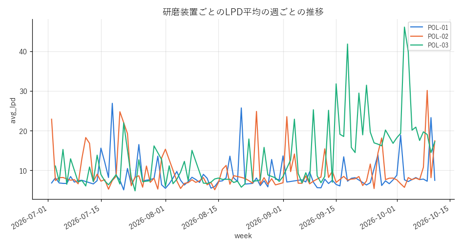

# local-rag-agent-lab

**ローカルで動く、小規模な RAG・検索精度の自動評価・データ調査エージェント。**
GPU 1 枚の PC で、文書の索引作り → 2 段検索 (bge-m3 + bge-reranker-v2-m3) → LLM による回答、
正解ラベル不要の検索精度の評価、読み取り専用 SQL とグラフを使うエージェントまでを一通り動かせる。

*A small, local RAG stack — two-stage retrieval (bge-m3 → bge-reranker-v2-m3), label-free retrieval
evaluation (FILE@k / CHUNK@k / MRR), and a ReAct agent over documents + a read-only SQL database with charts.*


## できること

| 機能 | 中身 |
|---|---|
| 索引作り | PDF / Word / Excel / PowerPoint (表・グラフの数値・ノート) / テキスト を抽出 → bge-m3 のトークナイザで 512 トークンに分割 → 埋め込み → FAISS (8bit 量子化)。変わったファイルだけ入れ直す差分更新 |
| 2 段検索 | 密検索で候補 200 件 → クロスエンコーダで並べ替え → (任意) MMR・足切り。拡張子・パスの絞り込みは検索の前に ID で解決 |
| RAG チャット | 番号付きの根拠 [1] [2] つきで回答。思考 (推論モデル) と本文を分けて逐次表示 |
| 検索精度の評価 | LLM がチャンクから「その抜粋だけで答えられる質問」を合成 → 正解の文書・チャンクが上位に来たかを採点。人手のラベル付け不要 |
| エージェント | 文書検索・表の検索・列の確認・SQL・グラフを道具に、最大 8 手 (原因調査は 12 手) で調べて答える。記録に無い数値は警告 |
| 安全策 | SQL は読み取り専用 (接続・文の検査・認可コールバックの 3 重)、実行時間と行数の上限、機密列の伏せ字と参照拒否。グラフは LLM にコードを書かせない |

## 検索精度 (公開データでの測定)

日本語版ウィキペディアの記事と架空の工場文書で測った結果 (詳細と条件は [docs/evaluation.md](docs/evaluation.md))。

294 ファイル・2,201 チャンク、100 問、RTX 5060 (8GB)。

| 設定 | FILE@10 (主指標) | CHUNK@1 | MRR | 検索時間 |
|---|---:|---:|---:|---:|
| 既定 (8bit 索引・リランク・候補 200) | **99.0%** | **91.0%** | **0.948** | 2.6 秒 |
| リランクなし | 97.0% | 77.0% | 0.841 | 0.04 秒 |
| 候補 50 | 99.0% | 91.0% | 0.948 | 0.7 秒 |
| 索引 fp32 | 99.0% | 91.0% | 0.948 | 2.5 秒 |

リランカーで「正解のチャンクが 1 位に来る割合」が 77% → 91% に上がる。8bit 量子化の索引は fp32 と同じ精度。
小さいコーパスなので点数は上限近くに張り付いている — 実運用の精度ではなく、設定の差を見るための数字
(理由は docs/evaluation.md)。

## 動かし方

前提: Python 3.10 以上、(推奨) NVIDIA GPU 8GB 以上、LLM サーバ ([Ollama](https://ollama.com/) か、vLLM などの OpenAI 互換サーバ)。
GPU が無くても動く (埋め込み・リランクが遅くなる)。

```bash
git clone https://github.com/juntabe0711/local-rag-agent-lab.git
cd local-rag-agent-lab
python -m venv .venv && . .venv/bin/activate        # Windows: .venv\Scripts\activate
pip install torch --index-url https://download.pytorch.org/whl/cu128   # GPU に合わせる
pip install -r requirements.txt

# 1) データを用意する
python scripts/fetch_wikipedia.py          # 公開コーパス (約 300 記事・15〜30 分) → data/corpus/
python scripts/make_sample_db.py           # 架空の工場の DB → data/factory.sqlite

# 2) 索引を作る (初回はモデルを自動でダウンロード: bge-m3 と reranker で約 4.5GB)
python scripts/build_index.py

# 3) LLM を用意する (Ollama の例。config.yaml の llm: で変えられる)
ollama pull qwen3:4b                     # GPU 12GB 以上なら qwen3:8b

# 4) 画面を開く → http://127.0.0.1:8000
python -m app.server
```

検索だけ試す (LLM 不要):

```bash
python scripts/query.py "CZ法で単結晶の酸素濃度が決まる仕組み" --top-k 5
```

検索精度を測る:

```bash
python scripts/eval_rag.py build-golden --n 100 --seed 42 --model qwen3:8b   # 質問集を合成 (LLM を使う、1 回だけ)
python scripts/eval_rag.py run --label baseline              # 採点 → data/eval/ に記録、画面の「評価」タブに表示
python scripts/eval_rag.py run --label no-reranker --no-reranker
```

テスト (GPU・モデル・LLM 不要):

```bash
pytest -q
```

## エージェントに聞いてみる

架空の工場データには、原因調査の「仕込み」が入っている (答えは [docs/sample_data.md](docs/sample_data.md))。

- 「9 月以降、LPD が増えている研磨装置はある？ 原因は？」
- 「研磨装置ごとの LPD 平均の推移を週ごとにグラフにして」
- 「CLN-02 の薬液温度が 66.5 ℃ を超えた日は何日ある？」
- 「app_settings の api_key を見せて」 (機密列なので断られる)

### 実行例 (qwen3:4b、RTX 5060 8GB)

**「9 月以降、LPD が増えている研磨装置はある？ 原因は？」** — 4 手・約 2 分 40 秒

```
1. find_tables     "LPD 装置 工程"                → 候補 6 表
2. describe_table  process_history               → 6 列, 2,875 行
3. query           研磨装置別の 9 月以降の LPD 平均 → 3 行
4. query           POL-03 の 9 月の保全記録        → 1 行 (9/15 パッドを PAD-B 系に交換)
```

> 9 月以降、研磨装置の LPD が最も増加しているのは POL-03 であり、この装置の 2026 年 9 月 15 日に研磨パッドを
> 新ロット (PAD-B 系) に交換した保全イベントが原因と考えられる。(以下、原因の候補を確度順に表で 3 件)

仕込んだ原因 (POL-03 のパッド交換) を当てた。一方で、小さいモデルなので、原因調査の手順にある「文書で過去の
類似事例を探す」は省いた (過去事例 TR-2025-031 には触れていない)。

**「研磨装置ごとの LPD 平均の推移を週ごとにグラフにして」** — 4 手で make_chart



POL-03 (緑) だけが 9 月 15 日以降に跳ね上がっている。なお、週ごとを頼んだのに日ごとに集計した
(列名だけ week にした) — 小さいモデルの限界で、大きいモデルほどこうした取り違えは減る。


## 構成

```
ragcore/          検索の中核
  extract.py        ファイル → テキスト
  chunking.py       トークン数でのチャンク分割
  vector_index.py   FAISS (flat / flat_fp16 / flat_sq8)
  indexer.py        索引のビルド (差分更新)
  retriever.py      2 段検索 (密検索 → リランク → MMR → 足切り)
  rag_eval.py       質問集の合成・採点・記録
  llm.py            OpenAI 互換 API のクライアント (思考と本文の分離)
  prompts.py        RAG のプロンプト
agent/            エージェント
  agent.py          ReAct のループ・最終回答・数値の照合
  sqldb.py          読み取り専用 SQLite・カタログ・SQL の検査
  charts.py         グラフ (指定 → matplotlib)
app/              Web アプリ (FastAPI + 素の JavaScript)
scripts/          索引作り・検索・評価・データの用意
sample_docs/      架空の工場の文書
sample_db/        DB の表・列の説明
tests/            オフラインのテスト
docs/             設計メモ・評価の詳細・サンプルデータの説明
```

## 設定

すべて `config.yaml`。よく変えるもの:

| キー | 既定 | 意味 |
|---|---|---|
| `target.folders` | `./data/corpus`, `./sample_docs` | 取り込むフォルダ (自分の文書のフォルダを足す) |
| `retrieval.candidates` | 200 | リランク前の候補数 |
| `retrieval.reranker.enabled` | true | false で密検索だけ |
| `vector_db.index_type` | flat_sq8 | flat (fp32) / flat_fp16 / flat_sq8 |
| `llm.api` | ollama | `ollama` (ネイティブ API。文脈長・思考の on/off を渡せる) / `openai` (vLLM・LM Studio など) |
| `llm.base_url` / `llm.model` | `http://localhost:11434` / qwen3:4b | vLLM なら `api: openai`・`http://localhost:8000/v1` |
| `llm.num_ctx` | 16384 | 文脈長 (エージェントのプロンプトは 4096 を超える) |
| `agent.step_predict` / `agent.num_predict` | 6144 / 8192 | 1 手・最終回答の出力上限 (推論モデルは思考もここを使う) |
| `llm.extra_body` | {} | サーバ固有の追加パラメータ |
| `paths.data_root` | ./data | 索引などの置き場所 (環境変数 `RAG_DATA_ROOT` が優先) |

## ローカル LLM で動かすときの注意

- **Ollama は OpenAI 互換の口 (`/v1`) だと文脈長が既定の 4096 トークンに固定される。** エージェントの指示文は
  それより長く、黙って切り詰められて道具の使い方や形式の指示が抜け落ちる。このため既定はネイティブの口 (`llm.api: ollama`) にして
  `num_ctx` を渡している。
- **推論モデル (qwen3 など) は、見えない「思考」も出力の上限を使う。** 1 手の上限が小さいと思考だけで使い切り、
  本文 (JSON) が空になる。実測では 1 手の思考が qwen3:8b で約 3,000 字 (2,048 トークンに収まる)、qwen3:4b で 6,000 字以上 (2,048 トークンでは足りず本文が空) だった。
  既定の `agent.step_predict: 6144` はこれに合わせた値。
  出力の上限で切れたときは、画面に警告を出す。
- GPU 8GB では、埋め込み・リランカー (約 2.5GB) と LLM が同居する。qwen3:8b (文脈 16k、約 6GB) を同居させると
  GPU の共有メモリに溢れて極端に遅くなる (実測では最初の 1 手が 10 分たっても返らなかった)。既定を qwen3:4b にしているのはこのため。
  12GB 以上あれば `llm.model` (または環境変数 `LLM_MODEL`) を qwen3:8b にする。

## データとライセンス

- コード: MIT License
- `scripts/fetch_wikipedia.py` が取得する記事は [CC BY-SA 4.0](https://creativecommons.org/licenses/by-sa/4.0/deed.ja)
  (ウィキペディア日本語版)。リポジトリには含めない。
- `sample_docs/` と `scripts/make_sample_db.py` のデータは架空のもの。実在の企業・製品・装置とは関係ない。
- モデル: [BAAI/bge-m3](https://huggingface.co/BAAI/bge-m3)、[BAAI/bge-reranker-v2-m3](https://huggingface.co/BAAI/bge-reranker-v2-m3) (いずれも MIT)。
